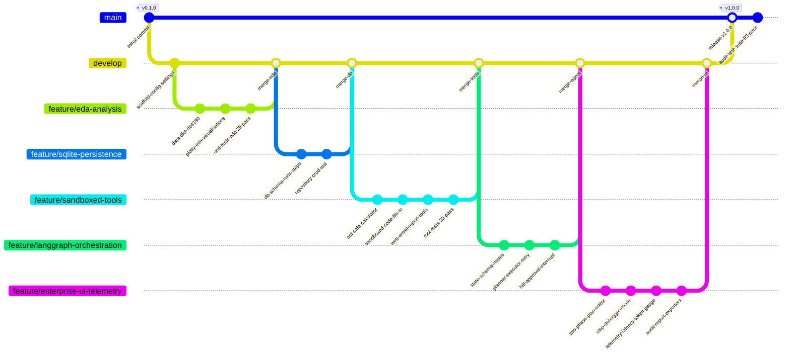
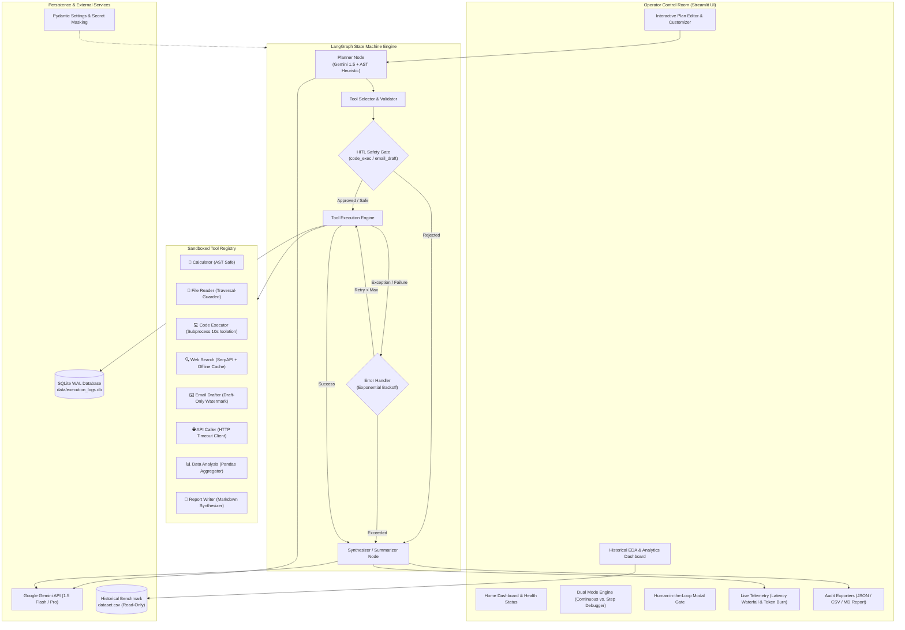
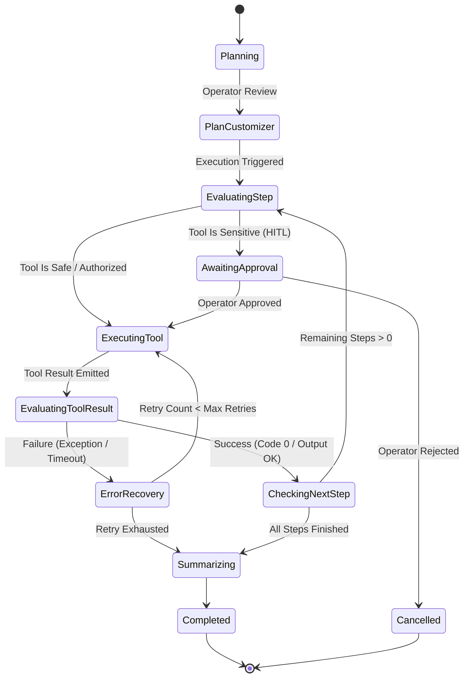

# Agentic AI Task Planner

**HCLTech Career Shaper Programme | Project No. 77 | Individual Engineering Capstone**

[](https://www.python.org/)
[](https://github.com/langchain-ai/langgraph)
[](https://pytest.org/)
[](https://streamlit.io/)
[](https://www.sqlite.org/)

---

## 📌 Executive Summary

The **Agentic AI Task Planner** is an enterprise-grade autonomous agentic application that transforms high-level, unstructured natural-language objectives into deterministic, multi-step execution graphs. 

Powered by **LangGraph** and the **Google Gemini API**, the system orchestrates 8 sandboxed tools, enforces rigorous Human-in-the-Loop (HITL) safety gates before high-risk actions, records immutable audit trails in SQLite, and provides live runtime telemetry through an interactive Streamlit console.

---

## 🔄 Git Branching & Engineering Lifecycle

The development of this project followed a structured Git feature-branch model, progressing from exploratory data analysis and database scaffolding to sandboxed tool verification, state-machine orchestration, and enterprise observability.



---

## 🏛️ System Architecture

The application is structured into decoupled layers ensuring high maintainability, strict separation of concerns, and robust testability:



---

## ⚡ LangGraph Finite State Machine

Execution flows dynamically through an interrupted cyclic graph:



---

## 🚀 Key Enterprise Capabilities

### 1. Two-Phase Interactive Planning
- **Separated Plan Generation:** Natural-language objectives are decomposed into structured JSON tool plans before execution starts.
- **Interactive Plan Editor:** Operators can inspect step parameters, adjust inputs (e.g., query strings, mathematical expressions, file targets), delete unnecessary steps, or inject custom steps on the fly.

### 2. Dual Execution Modes
- **Continuous Run Mode:** Executes the plan autonomously, pausing solely when encountering sensitive operations.
- **Step-by-Step Debugger Mode:** IDE-like single-step control (**`Execute Step N ⏭️`**). Allows operators to inspect intermediate state updates, duration, and output buffers before advancing.
- **Human-in-the-Loop (HITL) Review:** Sensitive actions (`code_exec`, `email_draft`) trigger a confirmation modal displaying exact action payloads.

### 3. Real-Time Telemetry & Observability
- **Latency Waterfall Chart:** Interactive Plotly dark-mode breakdown of execution seconds per tool.
- **Token Budget Burn Gauge:** Real-time indicator displaying cumulative token expenditure against safety ceilings.
- **Inference Cost Meter:** Live calculation of compute costs based on LLM token rates.

### 4. One-Click Audit & Executive Export
- **Full Audit Trace (JSON):** Complete schema trace with timestamps, tool inputs, outputs, errors, and approvals.
- **Executive Summary (Markdown):** Self-contained, publication-ready report formatted for stakeholder briefing.
- **Step Metrics (CSV):** Tabular export for offline spreadsheet analysis or audit filing.

---

## 🧰 Sandboxed Tool Suite

| Tool Identifier | Module | Security & Sandbox Mechanism | Sensitive? |
|---|---|---|:---:|
| `calc` | [`calculator.py`](file:///src/agent/tools/calculator.py) | **AST Evaluation** via `ast.parse` and math operators. Zero `eval()` or `exec()`. | No |
| `file_read` | [`file_reader.py`](file:///src/agent/tools/file_reader.py) | **Path Traversal Guard**: Canonical path resolution verified against directory whitelist. | No |
| `code_exec` | [`code_executor.py`](file:///src/agent/tools/code_executor.py) | **Process Isolation**: Subprocess execution with strict 10s timeout and memory limits. | **Yes** (HITL) |
| `web_search` | [`web_search.py`](file:///src/agent/tools/web_search.py) | SerpAPI web query with deterministic offline cached responses fallback. | No |
| `email_draft` | [`email_drafter.py`](file:///src/agent/tools/email_drafter.py) | Generates structured text only with mandatory `[DRAFT - NOT SENT]` watermark. Zero SMTP. | **Yes** (HITL) |
| `api_call` | [`api_caller.py`](file:///src/agent/tools/api_caller.py) | HTTP client with configurable 10s timeout, status validation, and header masking. | No |
| `data_analysis` | [`data_analysis.py`](file:///src/agent/tools/data_analysis.py) | Read-only Pandas summary statistics, missing value audit, and correlation matrices. | No |
| `report_write` | [`report_writer.py`](file:///src/agent/tools/report_writer.py) | Structured Markdown synthesis with executive summary and key findings. | No |

---

## 💾 SQLite Runtime Schema

Live agent execution traces are recorded to `data/execution_logs.db` in SQLite WAL mode:

```sql
CREATE TABLE execution_runs (
    run_id          TEXT PRIMARY KEY,
    user_goal       TEXT NOT NULL,
    status          TEXT DEFAULT 'pending',   -- pending | running | completed | failed | cancelled
    created_at      TEXT NOT NULL,
    completed_at    TEXT,
    total_tokens    INTEGER DEFAULT 0,
    total_duration  REAL DEFAULT 0.0,
    plan_json       TEXT,
    final_result    TEXT,
    error_message   TEXT
);

CREATE TABLE execution_steps (
    step_id           INTEGER PRIMARY KEY AUTOINCREMENT,
    run_id            TEXT NOT NULL REFERENCES execution_runs(run_id) ON DELETE CASCADE,
    step_order        INTEGER NOT NULL,
    tool_called       TEXT NOT NULL,
    tool_input        TEXT,
    tool_output       TEXT,
    tool_success      INTEGER NOT NULL,          -- 0 or 1
    planned_action    TEXT,
    tokens_used       INTEGER DEFAULT 0,
    duration_s        REAL DEFAULT 0.0,
    retry_count       INTEGER DEFAULT 0,
    error_message     TEXT,
    requires_approval INTEGER DEFAULT 0,
    approved          INTEGER,                    -- NULL=not asked, 0=rejected, 1=approved
    created_at        TEXT NOT NULL
);
```

---

## 📂 Repository Layout

```
AI Task Planner/
├── dataset.csv                          # Historical benchmark traces (500 rows, read-only)
├── data_dictionary.csv                  # Column metadata with RFC-4180 definitions
├── pyproject.toml                       # Build configuration and pytest flags
├── requirements.txt                     # Pinned project dependencies
├── .env.example                         # Environment variable template
├── .gitignore                           # Ignored caches, DB files, and credentials
├── README.md                            # Comprehensive project documentation
│
├── src/
│   ├── config/
│   │   ├── __init__.py
│   │   └── settings.py                 # Pydantic Settings, SecretStr masking, .env reloader
│   │
│   ├── agent/
│   │   ├── __init__.py
│   │   ├── state.py                    # AgentState and StepResult TypedDict definitions
│   │   ├── graph.py                    # LangGraph StateGraph builder with conditional edges
│   │   ├── planner.py                  # Gemini prompt decomposition with heuristic fallback
│   │   ├── executor.py                 # Step execution node and trace accumulator
│   │   ├── error_handler.py            # Exponential retry handler
│   │   ├── summarizer.py               # Final result synthesis node
│   │   └── tools/
│   │       ├── base.py                 # ToolResult dataclass and base tool signatures
│   │       ├── registry.py             # Tool discovery, dispatch, and sensitive flag lookup
│   │       ├── calculator.py           # AST-safe mathematical evaluation
│   │       ├── file_reader.py          # Path traversal-guarded file reader
│   │       ├── code_executor.py        # 10s timeout subprocess sandbox
│   │       ├── web_search.py           # SerpAPI client + deterministic offline cache
│   │       ├── email_drafter.py        # Watermarked email draft generator
│   │       ├── api_call.py             # Sandboxed HTTP client
│   │       ├── data_analysis.py        # Pandas profiling & tabular analytics
│   │       └── report_writer.py        # Markdown executive report writer
│   │
│   ├── db/
│   │   ├── __init__.py
│   │   ├── models.py                   # DDL scripts and table creation
│   │   └── repository.py               # Data access layer (parameterized queries, aggregations)
│   │
│   ├── eda/
│   │   ├── __init__.py
│   │   └── analysis.py                 # Comprehensive EDA producing 7 visualisations
│   │
│   └── ui/
│       ├── __init__.py
│       ├── app.py                      # Multi-page Streamlit portal & system overview
│       ├── styles.py                   # Enterprise dark-theme CSS design tokens
│       ├── pages/
│       │   ├── 1_Task_Planner.py       # Two-phase planner, step debugger, and HITL gate
│       │   ├── 2_Execution_Logs.py     # SQLite trace browser, search, and CSV drilldown
│       │   └── 3_EDA_Dashboard.py      # Interactive Plotly charts & dataset exploration
│       └── components/
│           ├── plan_editor.py          # Interactive JSON argument customizer
│           ├── plan_viewer.py          # Visual step flow indicator
│           ├── trace_viewer.py         # Real-time execution log renderer
│           ├── telemetry_viewer.py     # Latency waterfall & token burn gauge
│           └── export_tools.py         # 1-click audit JSON / CSV / MD exporters
│
├── tests/
│   ├── conftest.py                     # Mock fixtures for Gemini API and in-memory SQLite
│   ├── test_config.py                  # 8 tests for Pydantic settings & validation
│   ├── test_db.py                      # 11 tests for SQLite CRUD & cascade operations
│   ├── test_eda.py                     # 29 tests for statistics & visualisation integrity
│   ├── test_tools.py                   # 30 tests for all 8 sandboxed tools
│   ├── test_planner.py                 # 5 tests for Gemini & heuristic planning
│   ├── test_executor.py                # 3 tests for step execution & state accumulation
│   ├── test_graph.py                   # 5 tests for LangGraph state machine & HITL
│   └── test_ui.py                      # 2 tests for UI components and page imports
│
├── docs/
│   ├── architecture.md                 # Deep-dive architectural specification
│   └── project_synopsis.md             # Formal academic project synopsis document
│
├── outputs/
│   └── eda/                            # 6 HTML Plotly figures + 1 PNG correlation matrix
│
└── data/
    └── execution_logs.db               # SQLite database file (gitignored)
```

---

## 🛠️ Installation & Setup

### Prerequisites
- Python 3.10, 3.11, 3.12, or 3.14
- Google Gemini API key (obtainable via [Google AI Studio](https://aistudio.google.com/apikey))

### 1. Clone & Set Up Virtual Environment

```bash
# Clone the repository
git clone <repository_url>
cd "AI Task Planner"

# Create and activate virtual environment
python -m venv .venv

# Windows
.venv\Scripts\activate

# Linux / macOS
source .venv/bin/activate
```

### 2. Install Dependencies

```bash
pip install -r requirements.txt
```

### 3. Configure Environment Variables

```bash
# Copy template configuration
cp .env.example .env
```

Open `.env` in an editor and configure your credentials:

```ini
# Google Gemini API Key
GOOGLE_API_KEY=your_actual_gemini_api_key_here
GEMINI_MODEL=gemini-1.5-flash

# SQLite Persistence Path
DATABASE_PATH=data/execution_logs.db

# Optional Web Search Key (Falls back to offline cache if empty)
SERPAPI_API_KEY=

# Safety & Isolation Controls
MAX_CODE_EXEC_TIMEOUT=10
ALLOWED_FILE_READ_DIRS=.,./data,./outputs
EMAIL_DRAFT_ONLY=true
MAX_STEPS_PER_RUN=10
MAX_TOKENS_PER_RUN=50000
```

---

## 🚀 Running the Application

Launch the enterprise Streamlit application:

```bash
streamlit run src/ui/app.py --server.port 8501
```

Once started, navigate to:
- **Local URL:** `http://localhost:8501`
- **Network URL:** `http://<your-ip>:8501`

### Running the Standalone EDA Pipeline

To execute the offline exploratory data analysis pipeline on `dataset.csv`:

```bash
python -m src.eda.analysis
```

Outputs will be rendered to `outputs/eda/`:
- `tool_usage_distribution.html`
- `tool_success_rates.html`
- `token_usage_distribution.html`
- `duration_by_tool.html`
- `retry_count_distribution.html`
- `retry_vs_failure.html`
- `correlation_heatmap.png`

---

## 🧪 Testing Suite (Credit-Efficient)

The test suite incorporates mock fixtures for Gemini LLM calls and in-memory SQLite databases, allowing the entire suite of **93 tests** to run in under 30 seconds with **zero API credit consumption**.

```bash
# Execute all tests
pytest

# Execute with detailed coverage report
pytest --cov=src --cov-report=term-missing

# Run specific module tests
pytest tests/test_tools.py -v
pytest tests/test_graph.py -v
```

### Test Suite Summary

```text
============================= test session starts =============================
platform win32 -- Python 3.14.6, pytest-9.0.2
collected 93 items

tests\test_config.py ........                                            [  8%]
tests\test_db.py ...........                                             [ 20%]
tests\test_eda.py .............................                          [ 51%]
tests\test_executor.py ...                                               [ 54%]
tests\test_graph.py .....                                                [ 60%]
tests\test_planner.py .....                                              [ 65%]
tests\test_tools.py ..............................                       [ 97%]
tests\test_ui.py ..                                                      [100%]

======================= 93 passed, 6 warnings in 27.83s =======================
```

---

## 🛡️ Security & Ethical Guardrails

As highlighted in the project specification, autonomous agents equipped with tool execution capabilities present distinct security considerations. The following controls are implemented:

1. **Subprocess Isolation:** The `code_exec` tool runs arbitrary Python code strictly within a subprocess limited to 10 seconds with restricted memory buffers.
2. **Path Traversal Defenses:** `file_read` resolves canonical real paths and validates that requested files reside strictly within whitelisted boundaries (`ALLOWED_FILE_READ_DIRS`).
3. **No-Send Email Policy:** `email_draft` only produces watermarked draft text; no network socket or SMTP transport is instantiated.
4. **Credential Masking:** All API keys are loaded via Pydantic `SecretStr` models, preventing leakage in stdout, SQLite databases, or Streamlit session states.
5. **AST Safe Evaluation:** The `calc` tool uses Python Abstract Syntax Tree analysis to whitelist mathematical operators, preventing arbitrary code injection through `eval()`.
6. **SQL Injection Defense:** All queries to `execution_logs.db` use parameterized placeholders (`?`).

---

## 📜 Academic Integrity & Project Information

- **Program:** HCLTech Career Shaper Programme (2025–2026)
- **Project Number:** 77
- **Project Title:** Agentic AI Task Planner
- **Author:** Individual Engineering Project
- **Documentation:** See [`docs/architecture.md`](file:///docs/architecture.md) and [`docs/project_synopsis.md`](file:///docs/project_synopsis.md) for complete technical and academic documentation.
