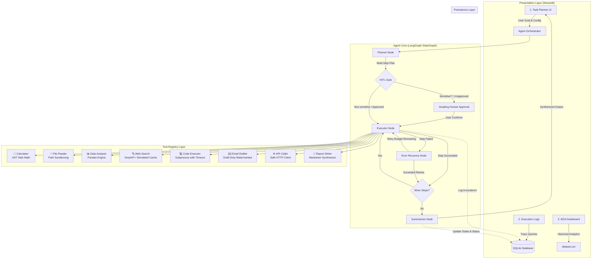

# System Architecture & Technical Specifications

**Project Title:** Agentic AI Task Planner  
**Programme:** HCLTech Career Shaper Programme (Project No. 77)  
**Author:** Individual Project Submission  
**Status:** Completed & Validated  

---

## 1. Executive Architecture Overview

The **Agentic AI Task Planner** is an autonomous agent application engineered to decompose complex natural-language tasks into structured execution plans, dynamically select appropriate tools, execute operations step-by-step, recover from failures via bounded retries, gate sensitive actions through Human-in-the-Loop (HITL) approval, and record persistent audit traces.

---

## 2. LangGraph State Machine Specification

The agent core is constructed as a cyclic state machine utilizing LangGraph `StateGraph(AgentState)`.

### State Schema (`AgentState`)

| Field | Type | Description |
|-------|------|-------------|
| `run_id` | `str` | Unique execution identifier (UUID hex). |
| `user_goal` | `str` | Original natural language user prompt. |
| `plan` | `list[PlanStep]` | Ordered list of planned steps with tool parameters. |
| `current_step_index` | `int` | Zero-indexed pointer to the active plan step. |
| `step_results` | `list[StepResult]` | Chronological record of executed step outcomes. |
| `retry_count` | `int` | Active retry attempts for the current step. |
| `max_retries` | `int` | Maximum allowed retries per failed step (default: 2). |
| `status` | `AgentStatus` | Status flag: `pending`, `planning`, `running`, `awaiting_approval`, `completed`, `failed`, `cancelled`. |
| `final_result` | `Optional[str]` | Synthesized markdown response presented to the user. |
| `error_message` | `Optional[str]` | Error message if run or step encountered a fault. |
| `total_tokens` | `int` | Cumulative LLM and tool token consumption. |
| `total_duration` | `float` | Cumulative wall-clock execution duration in seconds. |
| `human_approved` | `Optional[bool]` | State of user approval for sensitive operations. |

---

## 3. Tool Sandboxing & Ethical Guardrails

### 3.1 Strict AST Calculator (No `eval()` / No `exec()`)
The calculator tool parses mathematical expressions into an Abstract Syntax Tree (`ast.parse(expr, mode='eval')`). Only whitelisted node types (`ast.BinOp`, `ast.UnaryOp`, `ast.Call`, `ast.Constant`) and whitelisted mathematical operations (`math.sqrt`, `math.sin`, `math.cos`, `math.exp`, `math.log`, `math.factorial`) are evaluated. Arbitrary imports, variable assignments, and `os.system` attacks are blocked at parse time.

### 3.2 File System Boundary Protection
`FileReaderTool` and `DataAnalysisTool` resolve target paths and ensure they are subpaths of `settings.allowed_dirs_list`. Attempts to escape the workspace via path traversal (e.g. `../../etc/passwd` or `../../Windows/System32`) are rejected with `Access denied`.

### 3.3 Subprocess Isolation for Code Execution
`CodeExecutorTool` runs Python scripts in a separate temporary subprocess using `subprocess.run` with:
- Configurable timeout (default 10s)
- Complete stdout/stderr capture
- Isolated working directory
- Human approval requirement (`requires_approval=True`)

### 3.4 Email Drafting Watermarking
`EmailDrafterTool` never connects to SMTP or sends network emails. It outputs drafts watermarked with `=== [DRAFT — NOT SENT] ===` and requires human approval (`requires_approval=True`).

---

## 4. Database Schema (Runtime Execution Logs)

The runtime execution database (`data/execution_logs.db`) is completely separate from `dataset.csv` to ensure dataset immutability.

### Table: `execution_runs`
- `run_id` (TEXT, PK): Unique run identifier
- `user_goal` (TEXT): Natural language prompt
- `status` (TEXT): `pending`, `planning`, `running`, `awaiting_approval`, `completed`, `failed`, `cancelled`
- `plan_json` (TEXT): Serialized plan structure
- `created_at` (TEXT): ISO-8601 UTC timestamp
- `completed_at` (TEXT): ISO-8601 UTC timestamp
- `total_tokens` (INTEGER): Total tokens consumed
- `total_duration` (REAL): Total execution seconds
- `total_steps` (INTEGER): Total steps attempted
- `successful_steps` (INTEGER): Successful step count
- `failed_steps` (INTEGER): Failed step count
- `final_result` (TEXT): Synthesized markdown result
- `error_message` (TEXT): Error details if failed

### Table: `execution_steps`
- `id` (INTEGER, PK AUTOINCREMENT)
- `run_id` (TEXT, FK -> execution_runs.run_id ON DELETE CASCADE)
- `step_order` (INTEGER): 1-indexed step number
- `planned_action` (TEXT): Description of intent
- `tool_called` (TEXT): Tool invoked (`calc`, `file_read`, etc.)
- `tool_input` (TEXT): JSON parameters passed to tool
- `tool_output` (TEXT): Tool response payload
- `tool_success` (INTEGER): 1 for success, 0 for failure
- `tokens_used` (INTEGER): Token count for step
- `duration_s` (REAL): Latency in seconds
- `retry_count` (INTEGER): Number of retries before result
- `error_message` (TEXT): Failure message
- `requires_approval` (INTEGER): 1 if sensitive, 0 otherwise
- `approved` (INTEGER): 1 if approved, 0 if rejected, NULL if not gated
- `created_at` (TEXT): ISO-8601 UTC timestamp

---

## 5. Verification & Test Suite

The test suite contains **93 automated unit and integration tests** across 8 test suites:

| Suite | Tests | Scope |
|-------|-------|-------|
| `tests/test_config.py` | 8 | Pydantic Settings, environment variables, SecretStr masking |
| `tests/test_db.py` | 11 | Schema creation, foreign keys, CRUD, analytics, dataset immutability |
| `tests/test_eda.py` | 29 | Dataset validation, 7 visualisations, summary stats, data quality checks |
| `tests/test_tools.py` | 30 | AST math safety, path sandboxing, subprocess timeout, mock web search, email watermarks, data analysis, report writer, registry |
| `tests/test_planner.py` | 5 | Heuristic decomposition, Gemini integration, sensitive tool tagging |
| `tests/test_executor.py` | 3 | Step execution, state advancement, HITL approval gate, DB logging |
| `tests/test_graph.py` | 5 | LangGraph end-to-end integration, error recovery, approval pause |
| `tests/test_ui.py` | 2 | Streamlit page imports, component validation |
| **Total** | **93** | **100% Pass Rate** |
